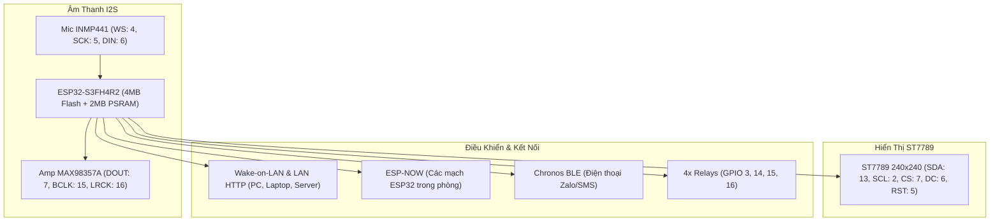

# 🤖 ESP32 Ni-Oh S3 Mini (Ni-Oh AI Assistant)

Firmware AI Robot để bàn thông minh chạy trên chip **ESP32-S3FH4R2** (4MB Flash + 2MB Quad PSRAM), tích hợp màn hình tròn/vuông ST7789 240x240, đôi mắt cảm xúc động, trình phát nhạc đĩa than xoay tròn Vinyl, kết nối điện thoại qua Chronos BLE và hệ thống điều khiển IoT (Wake-on-LAN máy tính, ESP-NOW, Bluetooth BLE).

---

## 📌 1. Sơ đồ Chân Phần Cứng (Hardware Pinout)

Cấu hình chân cố định chuẩn cho board mạch thực tế:

| Khối Chức Năng | Tên Chân Linh Kiện | Chân GPIO ESP32-S3 | Ghi chú kết nối |
| :--- | :--- | :--- | :--- |
| **Màn hình ST7789 (240x240)** | **SDA (MOSI)** | `GPIO 13` | SPI Data |
| | **SCL (SCLK)** | `GPIO 2` | SPI Clock |
| | **CS** | `GPIO 7` | Chip Select |
| | **DC** | `GPIO 6` | Data / Command |
| | **RST** | `GPIO 5` | Reset |
| | **BLK (Backlight)** | `3V3 / NC` | Nối trực tiếp nguồn 3.3V |
| **Microphone INMP441 (I2S)** | **WS (LRCK)** | `GPIO 4` | Word Select |
| | **SCK (BCLK)** | `GPIO 5` | Bit Clock |
| | **SD (DIN)** | `GPIO 6` | Data In |
| **Bộ khuếch đại MAX98357A** | **DIN (DOUT)** | `GPIO 7` | Data Out |
| | **BCLK** | `GPIO 15` | Bit Clock |
| | **LRC (LRCK)** | `GPIO 16` | Word Select / Left-Right |
| **Thẻ nhớ MicroSD (SPI)** | **MISO** | `GPIO 17` | SPI Data Out |
| | **MOSI** | `GPIO 18` | SPI Data In |
| | **CLK** | `GPIO 21` | SPI Clock |
| | **CS** | `GPIO 10` | Chip Select |
| **4 Kênh Rơ-le (Relays)** | **Relay 1** | `GPIO 3` | Điều khiển thiết bị 1 |
| | **Relay 2** | `GPIO 14` | Điều khiển thiết bị 2 |
| | **Relay 3** | `GPIO 15` | Điều khiển thiết bị 3 |
| | **Relay 4** | `GPIO 16` | Điều khiển thiết bị 4 |
| **Nút bấm & Báo hiệu** | **Nút Boot / Trò chuyện**| `GPIO 0` | Nhấn để trò chuyện / Cấu hình Wi-Fi |
| | **LED Tích hợp** | `GPIO 21` | Đèn trạng thái |



---

## ✨ 2. Tính năng nổi bật

### ⏰ Đồng hồ & Thời tiết khi nghỉ (Màn hình chờ sau 5s Idle)
* Khi không có người trò chuyện hoặc thao tác trong vòng **5 giây**, màn hình sẽ tự động kích hoạt chế độ **Màn hình chờ Đồng hồ & Thời tiết**:
  * Hiển thị giờ điện tử rõ nét (Giờ:Phút) đồng bộ chuẩn xác từ máy chủ thời gian internet (SNTP / Chronos BLE).
  * Cập nhật thông tin thời tiết địa phương theo thời gian thực (nhiệt độ, độ ẩm, mây/nắng).
  * Hỗ trợ tùy biến và chuyển đổi các mẫu thiết kế màn chờ (Idle Presets) qua thẻ nhớ SD hoặc bộ nhớ mặc định.
  * Ngay khi người dùng cất giọng nói hoặc bấm nút Boot, thiết bị lập tức thoát màn chờ để hiện đôi mắt cảm xúc và phụ đề trò chuyện máy đánh chữ.

### 🎶 Trình phát nhạc Đĩa Than Vinyl 360°
* Khi nghe nhạc trực tuyến (SoundCloud / OCS), giao diện màn hình tự động chuyển sang chiếc đĩa than Vinyl cổ điển đường kính 136px.
* Hoạt ảnh xoay tròn 360° vô hạn với hiệu ứng rãnh đĩa phản quang và tâm đĩa đỏ cam bắt mắt.
* Tên bài hát và ca sĩ cuộn ngang mượt mà.

### 👀 Đôi mắt cảm xúc Động (Biorhythm)
* Tích hợp bộ file GIF biểu cảm mắt tự nhiên.
* Kịch bản nhịp sinh học tự động chớp mắt và liếc nhìn ngẫu nhiên mỗi 3-7 giây khi ở chế độ chờ.
* Đồng bộ cảm xúc ngay lập tức khi trò chuyện cùng người dùng (vui vẻ, ngạc nhiên, suy nghĩ, buồn bã...).

### 📱 Đồng bộ Điện thoại qua Chronos BLE
* Bật Bluetooth trên điện thoại, kết nối app **Chronos** với thiết bị **`Ni-Oh S3`**.
* Đồng bộ giờ tự động, theo dõi dung lượng pin điện thoại.
* Hiển thị pop-up thông báo tin nhắn (Zalo, Tin nhắn SMS, Cuộc gọi) bo góc viền xanh neon nổi bật trên màn hình.

### 💻 Quản lý Mạng LAN & Máy tính cơ quan / gia đình
* **Tự động dò quét LAN (`self.lan.scan_network`):** Phát gói NetBIOS Name Service (UDP 137), tự động tìm thấy tên máy tính Windows (`DESKTOP-xxx`, `PC-KETOAN`), dải IP và tra cứu Vendor hãng sản xuất (*Dell, HP, Apple MacBook, Lenovo, Asus...*).
* **Ghi nhớ vĩnh viễn NVS Flash (`self.lan.remember_computer`):** Gán máy tính của bạn thành "Máy của tôi" và lưu vào bộ nhớ Flash vĩnh viễn (không mất khi cúp điện, siêu nhẹ ~50 bytes/máy, không sợ tràn RAM).
* **Đánh thức Wake-on-LAN:** Bật nguồn máy tính từ xa thông qua gói tin Magic Packet UDP port 9.
* **Điều khiển trạng thái:** Sleep, Shutdown, Lock màn hình, Mute loa qua mạng nội bộ.

### 📡 Sóng ESP-NOW & Bluetooth BLE
* Điều khiển tức thì các mạch ESP32 con trong phòng với độ trễ < 5ms (không cần qua router Wi-Fi).
* Quét và điều khiển bật/tắt các thiết bị Bluetooth Low Energy ở gần.

---

## ⚡ 3. Hướng dẫn Nạp Firmware (1-Click Flashing)

File nạp đã được gộp hoàn chỉnh (Merged 4MB) gồm Bootloader + Partition Table + NVS + Firmware App tại:
📁 **`esp32 Ni-Oh s3mn.bin`**

### Cách 1: Nạp trực tiếp qua Trình duyệt Web (Khuyên dùng)
1. Cắm cáp USB kết nối ESP32-S3 vào máy tính.
2. Mở trình duyệt Chrome hoặc Edge vào: [https://espressif.github.io/esptool-js/](https://espressif.github.io/esptool-js/) (hoặc [web.esphome.io](https://web.esphome.io)).
3. Chọn cổng COM của mạch ESP32-S3.
4. Chọn file **`esp32 Ni-Oh s3mn.bin`** và nhập offset là **`0x0`**.
5. Bấm **Program** để nạp.

### Cách 2: Nạp qua dòng lệnh esptool (Terminal / CMD)
```bash
esptool.py --chip esp32s3 -p COMx -b 921600 write_flash 0x0 "esp32 Ni-Oh s3mn.bin"
```
*(Thay `COMx` bằng cổng COM thực tế trên máy tính của bạn)*

---

## 🛠️ 4. Cấu trúc Dự Án

```
xiaozhi-s3mini-firmware/
├── CMakeLists.txt                      # Cấu hình dự án project(Ni-Oh)
├── sdkconfig.defaults.esp32s3          # Cấu hình chip S3FH4R2 (4MB Flash, 2MB PSRAM, NimBLE)
├── esp32 Ni-Oh s3mn.bin                # Bản nhị phân đóng gói 4MB hoàn chỉnh (Offset 0x0)
├── eye/                                # Thư viện GIF đôi mắt cảm xúc
├── main/
│   ├── boards/bread-compact-s3mini/    # Cấu hình phần cứng ST7789, GPIO, Rơ-le
│   │   ├── compact_s3mini_board.cc
│   │   ├── config.h
│   │   ├── iot_discovery_tools.h       # Công cụ AI: LAN Scan, NVS, Wake-on-LAN, ESP-NOW
│   │   ├── my_relays.h                 # Trình điều khiển 4 rơ-le
│   │   ├── s3mini_display.cc           # UI Đĩa than xoay 360°, Typewriter, Pop-up Chronos
│   │   └── s3mini_display.h
│   ├── chronos_ble/                    # Module dịch vụ Bluetooth Chronos
│   │   ├── chronos_service.cc
│   │   └── chronos_service.h
│   └── CMakeLists.txt                  # Tinh gọn loại bỏ driver thừa để tối ưu bộ nhớ
└── README.md
```

---

## 📜 Bản quyền
Dự án được tùy biến và phát triển tối ưu riêng cho **Ni-Oh AI Assistant**.
Tự do sử dụng, chỉnh sửa và phát triển cho các ứng dụng nhà thông minh cá nhân.
